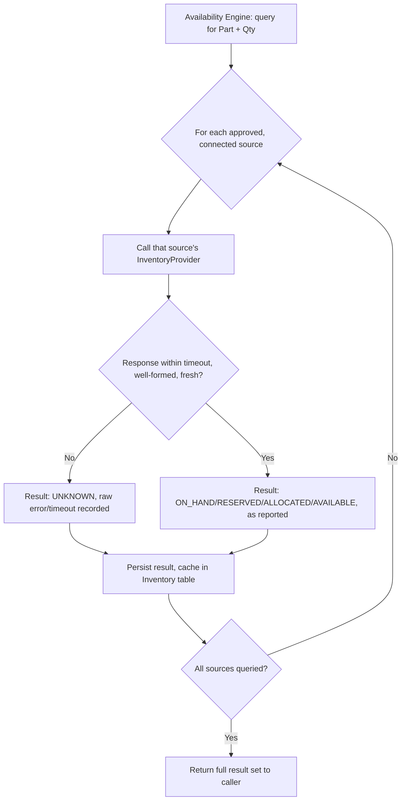

# Availability Architecture

```
Part + Quantity + Destination
        ↓
Availability Engine
        ↓
Candidate sources (Dealer, Regional Depot, Central Depot, Other approved source)
```

Implements Phase 1 `AVAILABILITY_PROCESS.md`. The Availability Engine lives in the Availability module (`BACKEND_ARCHITECTURE.md`) and never calls an external system directly — it calls one `InventoryProvider` adapter instance per approved, connected source.

## 1. `InventoryProvider` — conceptual interface

Kept conceptual in this phase (no code, no language-specific interface syntax) — this is the *contract* an adapter must fulfil:

| Aspect | Definition |
|---|---|
| Input | Part number, requested quantity, source identifier. |
| Output | On-hand quantity, reserved quantity, allocated quantity, available quantity (any of which may be absent), inventory timestamp, status (`ON_HAND/RESERVED/ALLOCATED/AVAILABLE/UNKNOWN`). |
| Timeout | A bounded, short timeout (exact value TO-BE, tuned once a real provider's latency is known); a provider that does not respond within it is treated identically to a failure. |
| Failure behaviour | Any error, timeout, or malformed response produces a result with status `UNKNOWN` — never an exception that aborts the whole Availability query for other sources, and never a fabricated quantity. |
| Stale-data behaviour | A response older than an agreed freshness threshold (TO-BE) is treated as `UNKNOWN`, with the stale timestamp preserved for transparency (Phase 1 failure case 5). |
| Unknown-data behaviour | If the provider itself cannot determine a figure (e.g., it returns "no data" rather than an error), the result is `UNKNOWN` — indistinguishable in *meaning* from a failure/timeout as far as downstream logic is concerned, though the raw response is preserved for audit. |
| Caching considerations | The Availability Engine caches the most recent result per (part, source) pair in PostgreSQL (`Inventory`, see `POSTGRESQL_DATA_ARCHITECTURE.md`) purely as a provenance record and a short-lived read optimisation — it never serves a cached result as if it were fresh beyond the freshness threshold above; a request past that threshold always re-queries. |
| Audit/provenance | Every result (success, `UNKNOWN`, or otherwise) is recorded with its source, raw response reference (where feasible), and timestamp — see `AUDIT_ARCHITECTURE.md`. |

## 2. Process flow



## 3. Provider registration (conceptual)

| Source | Provider status today |
|---|---|
| Dealer stock | No real `InventoryProvider` implementation exists — UNKNOWN whether dealer stock is digitally queryable at all (Phase 1 `HCME_CONFIRMED_VS_UNKNOWN.md`). A mock/test provider may exist for development, clearly labelled and never returned in a production response. |
| Regional depot | Same — UNKNOWN. |
| Central depot | Same — UNKNOWN. |
| Other approved source | Not yet defined; the interface accommodates it without a design change once one is approved. |

This means, honestly stated: **until a real inventory source is connected, every Availability query in production returns `UNKNOWN` for every source.** That is the correct behaviour per BR-01 — it is not a defect to be papered over with a fabricated default, and it is exactly what the Phase 1 process defines for this situation (see Phase 1 failure case 6).

## 4. Critical rule (restated)

> **UNKNOWN inventory must not become ZERO inventory**, anywhere in this architecture — not in the adapter, not in the Availability Engine, not in the API response, not in the frontend (see `FRONTEND_ARCHITECTURE.md` §4). This is enforced structurally: the status field is a required, distinct value from any quantity field, so a consumer cannot mistake "no data" for "quantity: 0" without actively ignoring the status.
