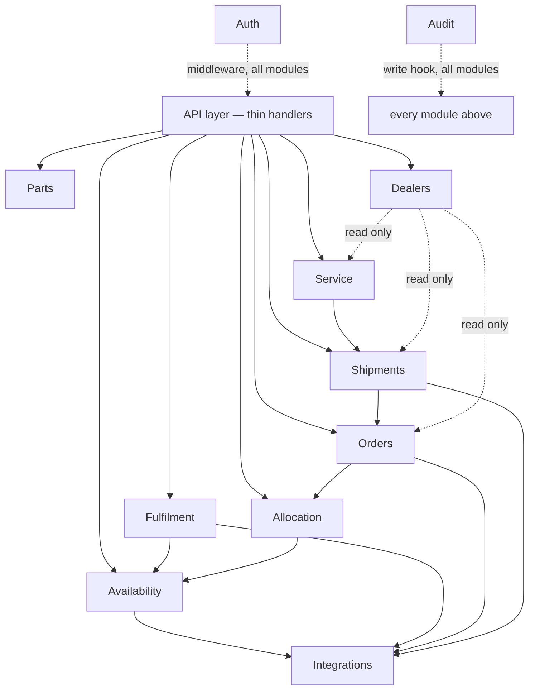

# Backend Architecture

> [!NOTE]
> **Architecture Decision Reconciliation (Phase 5 Consolidation)**:
> The active backend implementation is Python (FastAPI) structured as a modular monolith in `backend/app/`, backed by **Neo4j AuraDB as the sole database**.
> All domain modules persist directly to Neo4j nodes and relationships via Cypher. PostgreSQL has been removed. See `docs/NEO4J_ONLY_MIGRATION.md`.

**Decision:** modular monolith — one deployable codebase, organized into business-domain modules with enforced boundaries, deployed as FastAPI route handlers (`backend/app/`). No module below is a separate microservice.

## 1. Modules

| Module | Responsibility | Owns | Must NOT own |
|---|---|---|---|
| **Parts** | Represents the part identity/context handed off from the existing Parts Store; validates orderability. Does *not* own the catalogue itself. | Part Context validation logic. | The Parts Store catalogue (remains the existing frontend/static data); fitment data (owned by Neo4j graph, read-only from this module). |
| **Availability** | Implements the Availability Engine (`AVAILABILITY_ARCHITECTURE.md`): queries `InventoryProvider` adapters per approved source, applies the `ON_HAND/RESERVED/ALLOCATED/AVAILABLE/UNKNOWN` model. | Availability Results / `(:InventoryCache)` (Neo4j). | Inventory itself (owned externally, per source — UNKNOWN system); allocation decisions. |
| **Fulfilment** | Computes Fulfilment Options from Availability Results using `RoutingProvider`/`ShippingRateProvider` adapters; records the selected option. | Fulfilment Options / `(:FulfilmentOption)` (Neo4j). | Transport execution; allocation. |
| **Allocation** | Implements concurrency-safe allocation against a selected source (`ALLOCATION_ARCHITECTURE.md`). | Allocation records `(:Allocation)` and ledger `(:InventoryLedger)` (Neo4j). | Order creation; any HCME priority/VOR policy. |
| **Orders** | Creates an Order once an Allocation is `CONFIRMED`; resolves price/shipping/tax via `PricingProvider`/`OrderProvider` adapters. | Orders, Order Lines (Neo4j). | Pricing logic itself (delegated to `PricingProvider`); allocation state. |
| **Shipments** | Creates and tracks Shipments via `ShipmentProvider`/`TrackingProvider` adapters. | Shipments, Shipment Events (Neo4j). | Carrier selection policy beyond what the chosen Fulfilment Option specifies; Order state. |
| **Dealers** | Owns Dealer/Dealer Branch data as a first-class entity. | Dealer, Dealer Branch, Territory records (Neo4j). | Order or Shipment state. |
| **Service** | Owns the Service Job lifecycle (`SERVICE_ARCHITECTURE.md`). | Service Jobs, Service Parts (Neo4j). | Shipment/Dealer-receiving state. |
| **Integrations** | Hosts every adapter interface and the one real (or mock) implementation registered for it (`INTEGRATION_ARCHITECTURE.md`). | Adapter interfaces, provider registration/config, resilience wrapping. | Business decisions. |
| **Audit** | Records every business action: who, what, when, previous/new state, source, correlation ID. | Audit log records `(:AuditRecord)` (Neo4j). | Nothing else — write-mostly, read for compliance/debugging only. |
| **Authentication/Authorization** | Validates identity on every request; enforces dealer/customer/HCME-staff access separation (`SECURITY_ARCHITECTURE.md`). | Session/identity validation, authorization checks. | The identity provider itself. |

A cross-cutting **Fulfilment Request** concept (the Phase 1 state-machine parent tying the above together — `PROCESS_STATES.md` §A) is owned jointly by whichever module completes each stage, coordinated by a thin orchestration layer that only sequences calls and persists the overall state transition; it holds no business logic of its own (business logic lives in the module for that stage).

## 2. Dependency graph (allowed communication)

Rules:

- A module may depend "downward" on a module listed above it in its own column of the table (e.g., Orders depends on Allocation, not the reverse).
- **Only the Integrations module may call an external system.** No other module imports a carrier SDK, HTTP client to an external API, etc., directly (principle 6, enforced at the module level).
- **Dealers is read-mostly from other modules' perspective** — Orders/Shipments/Service reference a Dealer ID and may read Dealer data, but never write into Dealer-owned tables.
- **Audit is a horizontal concern** — every module that changes state calls into Audit; Audit never calls back into business modules.
- **Authentication/Authorization is enforced at the API layer** (middleware in front of every handler), not re-implemented per module.

## 3. What no module does

- No module talks to PostgreSQL or Neo4j through anything other than its own well-defined repository/query functions — no raw cross-module database access (this is what keeps a future extraction into separate services possible without a rewrite, per principle 5, without requiring it now per principle 4).
- No module fabricates a value for an UNKNOWN external dependency (principle 13) — it returns/records the absence explicitly, per Phase 1 BR-01 and the Availability/Fulfilment/Order documents.
