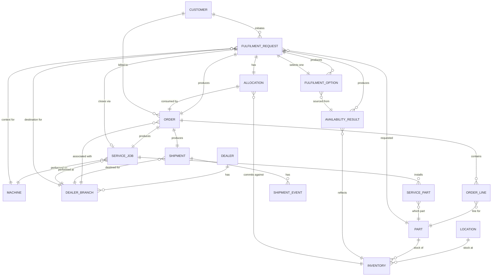

# Canonical Data Model

> [!NOTE]
> **Implementation Reconciliation (Phase 5 Consolidation)**:
> In the consolidated architecture (`docs/NEO4J_ONLY_MIGRATION.md`), this conceptual data model is implemented directly in **Neo4j AuraDB** as graph nodes and relationships (`FulfilmentRequest`, `FulfilmentOption`, `InventoryCache`, `InventoryLedger`, `Allocation`, `AuditRecord`, `IdempotencyRecord`, `PartsInquiry`).

A conceptual model connecting the entities the fulfilment process needs. `docs/NEO4J_ONLY_MIGRATION.md` details each entity's mapping into the active Neo4j graph model.

## Entity-relationship diagram



## How this supports the Phase 1 trace

```
Part → Availability → Fulfilment → Allocation → Order → Shipment → Dealer → Service → Close
```

| Phase 1 step | Canonical entities involved |
|---|---|
| Part | `PART`, referenced by `FULFILMENT_REQUEST` |
| Availability | `AVAILABILITY_RESULT` (reflecting `INVENTORY` at a `LOCATION`) |
| Fulfilment | `FULFILMENT_OPTION` (derived from `AVAILABILITY_RESULT`) |
| Allocation | `ALLOCATION` (commits against `INVENTORY`, belongs to `FULFILMENT_REQUEST`) |
| Order | `ORDER`, `ORDER_LINE` (consumes the `ALLOCATION`) |
| Shipment | `SHIPMENT`, `SHIPMENT_EVENT` (produced by `ORDER`) |
| Dealer | `DEALER`, `DEALER_BRANCH` (destination throughout; owns receiving) |
| Service | `SERVICE_JOB`, `SERVICE_PART` (produced once `SHIPMENT` is delivered) |
| Close | `FULFILMENT_REQUEST` reaches `COMPLETED` once `SHIPMENT` is `DELIVERED` and `SERVICE_JOB` is `COMPLETED` (Phase 1 `DEALER_SERVICE_PROCESS.md` §3) |

## Notes on entities not owned by PostgreSQL

- `MACHINE` and `PART`'s fitment relationship are read from Neo4j/the existing Parts Store, not owned transactionally here (see `NEO4J_ARCHITECTURE.md`, `DATA_OWNERSHIP.md`). They appear in this diagram as reference entities the transactional model points to, not as PostgreSQL-owned tables in the full sense — `PART` specifically is a lightweight reference (part number + whatever minimal fields the fulfilment process needs), not a duplicate of the catalogue.
- `CUSTOMER` and `DEALER`/`DEALER_BRANCH` are modelled with the fields the process requires (per Phase 1 `ACTORS_AND_RESPONSIBILITIES.md` §3), even though their actual data sources are UNKNOWN/TO-BE (see `DATA_OWNERSHIP.md`) — the shape is defined now so Phase 3 does not need to redesign the model once those sources are confirmed.
- `LOCATION` is a generalization over Dealer Branch, Regional Depot, Central Depot and any "other approved source" (Phase 1 `AVAILABILITY_PROCESS.md` §1) — a single concept so `INVENTORY` and `AVAILABILITY_RESULT` do not need source-specific variants.

## Multiplicity note

The model supports one part per Fulfilment Request today (matching Phase 1's traced scope) while allowing `ORDER_LINE` and `SERVICE_PART` to be one-to-many from the start — this avoids a schema change if multi-line orders or multi-part service jobs are needed later, without building that capability's business logic now (principle 2: simple, not speculative).
