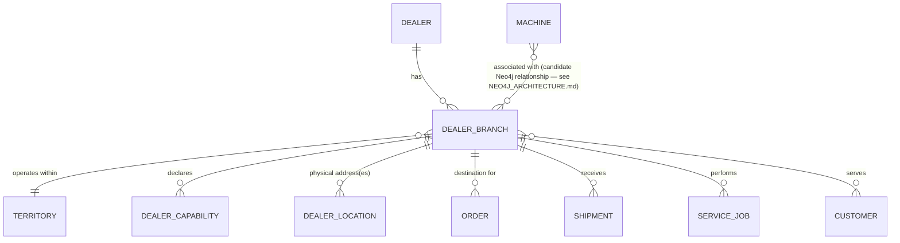

# Dealer Architecture

Dealer is a first-class entity throughout this architecture (Phase 1 `ACTORS_AND_RESPONSIBILITIES.md` §3), never a free-text field on an Order or Shipment (BR-10).

## 1. Conceptual model

## 2. Entities

| Entity | Purpose | Known HCME information | Required future data |
|---|---|---|---|
| Dealer | The organisation-level entity. | A dealer locator exists publicly (Phase 0 research), confirming dealers are a discoverable named entity. | Dealer master identifier scheme, legal entity data — UNKNOWN. |
| Dealer Branch | A physical location belonging to a Dealer. | Not confirmed at data level for Europe. | Branch identifier, address, contact — UNKNOWN. |
| Territory | The geographic area a Dealer/Branch serves. | Not confirmed for Europe (Phase 1 `HCME_CONFIRMED_VS_UNKNOWN.md`). | Territory boundaries/mapping — UNKNOWN. |
| Dealer Capability | What a Branch can do: stock capability, fulfilment capability, service capability (each a distinct flag/attribute, per Phase 1 `ACTORS_AND_RESPONSIBILITIES.md` §3). | Not confirmed for any specific dealer. | Per-branch capability data — UNKNOWN. |
| Dealer Location | Physical address(es) for a Branch, used as a Shipment destination. | Not confirmed. | Address data — UNKNOWN. |

**No specific HCME dealer capability is invented.** The Dealer Capability entity is modelled with the *shape* Phase 1 requires (stock/fulfilment/service flags) so the platform can represent a capability the moment it is confirmed — every instance is unpopulated/`UNKNOWN` until then, never defaulted to "yes" or "no."

## 3. Relationships to other entities

| Relationship | Nature |
|---|---|
| Dealer Branch → Customer | Many-to-many — a branch serves many customers; a customer may interact with more than one branch. Data source UNKNOWN. |
| Dealer Branch → Machine | Candidate Neo4j relationship (`NEO4J_ARCHITECTURE.md`) — "which dealer has a relationship with this machine" is relational and, once source data exists, graph-natural. Not required for the transactional flow. |
| Dealer Branch → Part / Inventory | Only via the `InventoryProvider` adapter for that dealer, if and when dealer stock is confirmed digitally queryable (`AVAILABILITY_ARCHITECTURE.md`) — not a direct data relationship owned here. |
| Dealer Branch → Order | One Order references at most one destination Dealer Branch (`POSTGRESQL_DATA_ARCHITECTURE.md`). |
| Dealer Branch → Shipment | The confirmed receiving party (`SHIPMENT_ARCHITECTURE.md` §5). |
| Dealer Branch → Service Job | The performing party (`SERVICE_ARCHITECTURE.md`). |

## 4. Where Dealer data lives

Per `DATA_OWNERSHIP.md`, Dealer/Dealer Branch is `UNKNOWN/TO-BE` for its authoritative source. This architecture's position: PostgreSQL holds the Dealer/Dealer Branch/Territory/Capability/Location tables as the platform's own reference copy (`POSTGRESQL_DATA_ARCHITECTURE.md`), populated via whatever source is eventually confirmed (a `DealerProvider` adapter — see `INTEGRATION_ARCHITECTURE.md` — or manual/administrative entry as an interim measure, itself a Phase 3 decision). Territory/relationship-heavy queries ("which dealer covers this postcode") are a Neo4j candidate once that data exists (`NEO4J_ARCHITECTURE.md`), read-through to the same underlying Dealer identifiers.
