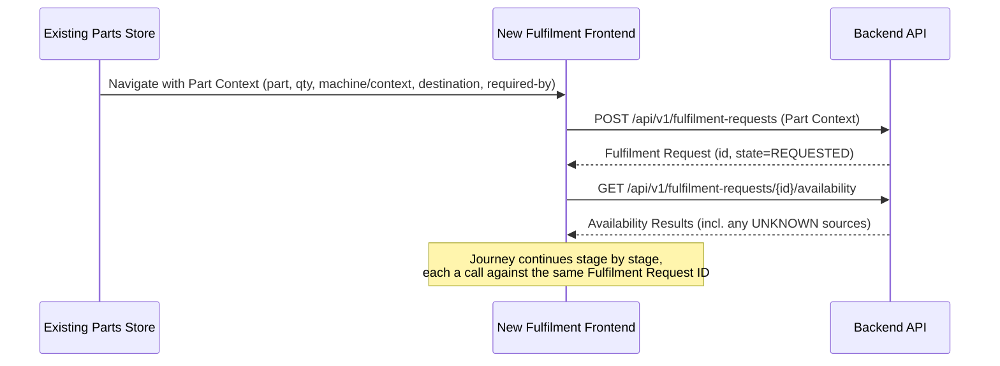

# Frontend Architecture

**Scope discipline:** the existing Parts Store (`frontend/pages/PartsStore`) is not redesigned. This document defines only the boundary where it hands off into the new fulfilment workflow, and the shape of that new workflow's own architecture — not its components or visual design (that is implementation, later).

## 1. Route / navigation boundary

- The existing Parts Store keeps its existing routes and behaviour unchanged.
- A new route namespace is introduced for the fulfilment workflow, e.g. `/fulfilment/:fulfilmentRequestId` and its stage sub-routes (`/fulfilment/:id/availability`, `/fulfilment/:id/options`, etc.) — exact routing structure is a Phase 3 implementation detail; what Phase 2 fixes is that it is a **separate route tree**, entered from, not merged into, the Parts Store's own routes.
- Entry point: an action on a selected part in the Parts Store (e.g., "Check availability" / "Request fulfilment") navigates into this new route tree, carrying the part context described in §5.

## 2. State ownership

| State | Owner | Notes |
|---|---|---|
| Parts Store catalogue state (what parts exist, images, pricing display today) | Existing Parts Store code — unchanged | Out of scope. |
| The part context handed into fulfilment (part number, quantity, machine/context, destination) | Created by the Parts Store hand-off, then owned by the backend once a Fulfilment Request exists | See §5. The frontend does not treat this as its own long-lived source of truth after hand-off — it re-fetches from the backend by Fulfilment Request ID (server state, not client-cached business state). |
| Fulfilment workflow state (current stage, Availability Results, Fulfilment Options, selected option, Allocation/Order/Shipment/Service status) | Backend (PostgreSQL), fetched per stage | The frontend holds only UI state (which stage is being viewed, form input in progress) — it never becomes the source of truth for business state, consistent with "backend owns business logic" (principle 8). |
| Session/user context | See §6 | Authentication model is UNKNOWN/TO-BE (Phase 1 `HCME_CONFIRMED_VS_UNKNOWN.md`); the frontend architecture assumes only that an authenticated identity is available to attach to requests, not a specific mechanism. |

## 3. API interaction

- All fulfilment-workflow screens call only the platform's own versioned backend API (`/api/v1/...` — see `API_ARCHITECTURE.md`), never an external system directly (principle 6) and never with embedded credentials (principle 7).
- Each stage of the journey (Availability, Fulfilment Options, Selection, Allocation, Order, Shipment, Dealer, Service) corresponds to one or more API calls; the frontend does not compute business decisions (e.g., which sources are queried, whether an allocation is safe) — it only presents backend-computed results and captures user selections, consistent with Phase 1's actor model (`ACTORS_AND_RESPONSIBILITIES.md`).

## 4. Loading and error states

Each stage screen defines three states, consistently:

| State | Meaning | Example |
|---|---|---|
| Loading | Waiting on the backend call for this stage. | Fetching Availability Results. |
| Success | Data returned and renderable. | Availability Results shown, including any `UNKNOWN`-status sources — see below. |
| Error | The backend call failed or a business-level failure occurred (see Phase 1 `FAILURE_AND_EXCEPTION_CASES.md`). | Allocation failed; part not orderable. |

**Rule carried over from Phase 1 (BR-01):** an `UNKNOWN` availability status from a source is not an error state — it renders as part of a normal Success response, clearly labelled, never silently omitted and never shown as confirmed zero stock.

## 5. How the selected part is represented

The hand-off from the Parts Store to the fulfilment workflow is a single, explicit **Part Context** object, matching Phase 1 Select Part's captured input (`HCME_PARTS_FULFILMENT_PROCESS.md` Stage 1):

| Field | Source |
|---|---|
| Part number | Parts Store's existing catalogue |
| Quantity | User input at hand-off |
| Machine/context (where available) | Parts Store's existing context, if the Parts Store has it |
| Customer | Session/authenticated identity (see §6) |
| Destination | User input at hand-off, or defaulted from a known dealer/customer profile — TO-BE, since dealer/customer identity data is UNKNOWN (Phase 1) |
| Required-by date (where applicable) | User input at hand-off |

This object is sent once, to create a Fulfilment Request (`POST /api/v1/fulfilment-requests` — see `API_ARCHITECTURE.md`); from that point on, the frontend refers to the Fulfilment Request by its ID, not by re-passing the part context around client-side.

## 6. Session/context handling

- Authentication/authorization mechanism is explicitly UNKNOWN/TO-BE (see `SECURITY_ARCHITECTURE.md` and Phase 1 `HCME_CONFIRMED_VS_UNKNOWN.md`).
- The frontend architecture assumes only that every API call carries an identity token the backend can validate and use to determine "who is this" (customer vs. dealer vs. HCME staff) and "what can they see" — it does not assume a specific provider (e.g., Entra ID) is already integrated.
- No credential, API key, or secret of any kind is held in frontend code or browser storage for any external system (principle 7) — this includes the future carrier, pricing, or inventory integrations; those live only behind the backend's Integration Adapters.

## 7. How the fulfilment workflow begins

The Parts Store itself never calls the fulfilment API directly for anything beyond this initial hand-off — from that point, the new fulfilment route tree owns the interaction, matching the "not redesigning the Parts Store" constraint.
