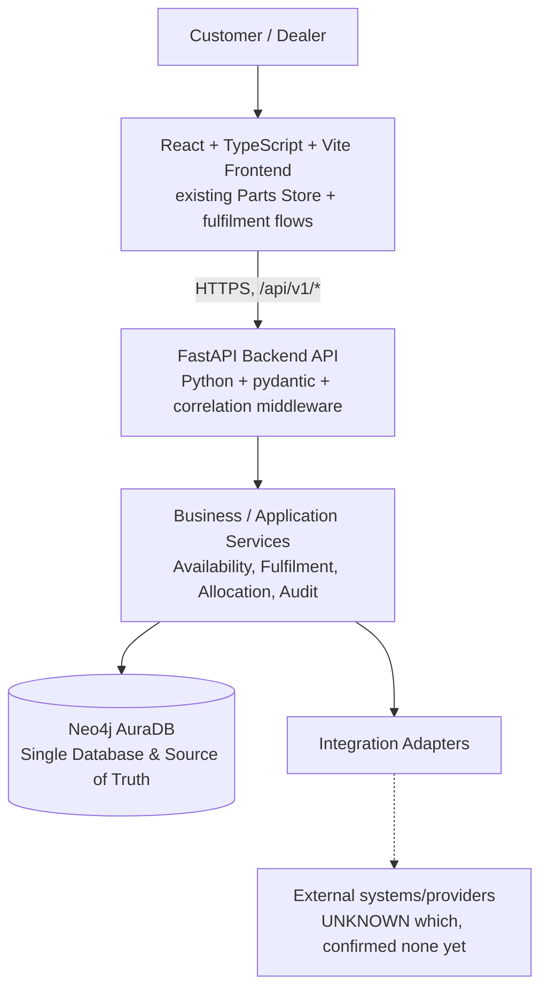

# High-Level Architecture

> [!NOTE]
> **Architecture Decision Reconciliation (Phase 5 Consolidation)**:
> The active architecture is consolidated to **Neo4j AuraDB as the sole database and single source of truth** (`CURRENT DATABASE = NEO4J ONLY`).
> The target architecture is:
> `React + TypeScript + Vite → Python + FastAPI → Neo4j AuraDB`
> PostgreSQL and all relational database dependencies (SQLAlchemy, psycopg) have been superseded and removed. See `docs/NEO4J_ONLY_MIGRATION.md`.

This is the architecture proposed in the Phase 2 brief, adopted with one refinement explained below.

## 2. Reasoning

- **Frontend stays React/Vite** — this is the existing, working technology (confirmed in the repository); Phase 1/2 both prohibit redesigning it.
- **Backend API + Business/Application Services are one deployable unit (a modular monolith), not separate services.** Per architectural principle 4/5 ("do not introduce microservices unless there is a demonstrated need"; "prefer a modular architecture that can evolve") and principle 2 ("as simple as possible while production-grade"). The ten business domains from Phase 1 (Parts, Availability, Fulfilment, Allocation, Orders, Shipments, Dealers, Service, Integrations, Audit, plus Authentication) do not have independent scaling, deployment, or team-ownership needs today that would justify the operational cost of microservices. See `ADR-004`.
- **The "Backend API" and "Business/Application Services" layers are architecturally distinct but not physically separate deployments.** The API layer is a thin, versioned contract surface (`API_ARCHITECTURE.md`); the service layer holds the actual business logic, mapped 1:1 to the Phase 1 process stages. This separation matters for testability and for keeping the API contract stable even if internal service logic changes.
- **PostgreSQL is the transactional source of truth** (mandated by principle 9) for everything with a lifecycle and a state machine: Fulfilment Requests, Allocations, Orders, Shipments, Service Jobs (see `POSTGRESQL_DATA_ARCHITECTURE.md`).
- **Neo4j is retained for relationship/context data only** — it is already integrated and proven valuable for exactly this (machine↔part fitment). Phase 2 does not introduce a new database for this purpose; it scopes Neo4j's role precisely and enforces that it never becomes a second source of truth for transactional facts (principle 11). See `NEO4J_ARCHITECTURE.md`.
- **Integration Adapters are the only path to any external system** (principle 6): the backend never calls an external system directly from a domain module — every external call goes through a named adapter interface (`InventoryProvider`, `PricingProvider`, etc. — see `INTEGRATION_ARCHITECTURE.md`), so a real implementation can be swapped in later without touching business logic, and so a failure is handled at one well-defined boundary.

## 3. Refinement adopted: deployment shape follows the existing, proven pattern

The repository already deploys the frontend and its backend functions to Vercel, as small serverless handlers under `frontend/api/*.js`, each with server-side-only credentials (confirmed in `frontend/api/_lib/neo4j.js`). Phase 2 does **not** introduce a new deployment model for the sake of novelty. Instead:

- The **modular monolith is a code-organization principle**, not a single always-on server process requirement: the business/application service modules live in one shared codebase with clear module boundaries (`BACKEND_ARCHITECTURE.md`), and the versioned API endpoints (`/api/v1/...`) are thin handlers that invoke those modules — matching the existing handler shape (`export default async function handler(req, res)`).
- This keeps the deployment as simple as what already exists (no new server to operate, no container orchestration to add) while still satisfying "modular monolith over microservices," because the *modules* are what matters for maintainability, not whether each request happens to run in its own serverless invocation.
- If a genuine scaling or latency need later demonstrates that a long-lived process (rather than serverless functions) is required, that is a Phase 3+ evolution — this architecture does not preclude it, and no module has been designed with cross-module in-memory state that would make that change hard (see `BACKEND_ARCHITECTURE.md` §Dependencies).

This is recorded formally in `ADR-001-SYSTEM-ARCHITECTURE.md`.

## 4. What this explicitly avoids

- No microservices split by business domain (principle 4).
- No new database technology beyond the two already mandated/present (PostgreSQL, Neo4j) — no cache layer, message broker, or search engine is introduced without demonstrated need (see `RESILIENCE_ARCHITECTURE.md` for where a queue is considered and rejected for now).
- No direct browser-to-external-system calls, and no credentials of any kind reach the frontend (principles 6–7) — the frontend only ever talks to `/api/v1/*` on the same platform.
