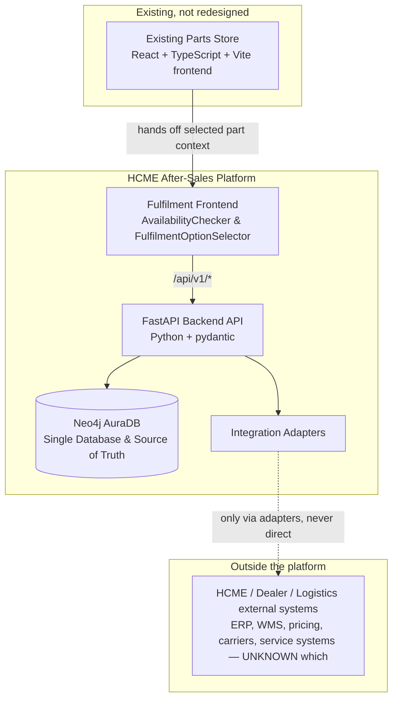

# System Boundary

**Phase:** 2 — Technical Architecture
**Input:** Phase 1 business process (frozen) + Phase 0 research + the existing repository (`frontend/`, `neo4j/`).

> [!NOTE]
> **Architecture Decision Reconciliation (Phase 5 Consolidation)**:
> In the consolidated architecture (`docs/NEO4J_ONLY_MIGRATION.md`), the backend is implemented in Python (FastAPI) and persists directly to **Neo4j AuraDB as the sole database and single source of truth**. PostgreSQL has been removed.

## 1. Boundary diagram

## 2. Component classification

| Component | Inside platform? | Notes |
|---|---|---|
| Frontend (existing Parts Store) | Yes — existing, unmodified | React + TypeScript + Vite app (`frontend/`). Hands off part context into fulfilment workflow. |
| Frontend (fulfilment workflow UI) | Yes | AvailabilityChecker & FulfilmentOptionSelector mounted in Parts Store. |
| Backend API | Yes | Python FastAPI backend (`backend/app/main.py`), versioned endpoints (`/api/v1/*`). |
| Neo4j AuraDB | Yes | Sole active database and source of truth for all operational entities and graph relationships. |
| Integration Adapters | Yes | Provider abstraction layer (`backend/app/integrations/contracts/`). Sole path to external systems. |
| External HCME/dealer/logistics systems (ERP, WMS, pricing, order system, carriers, service systems) | No — external | Confirmed to exist only as concepts in Phase 0/1 research; specific systems are UNKNOWN. See `DATA_OWNERSHIP.md`. |
| Human actors | No — external to the software, but part of the process | Customer, Dealer, Dealer Branch staff, Technician, HCME staff — see Phase 1 `ACTORS_AND_RESPONSIBILITIES.md`. |

## 3. External system classification

| External system/provider | Classification | Basis |
|---|---|---|
| HCME inventory source(s) (dealer/regional/central) | UNKNOWN | Not confirmed in Phase 0/1 research. |
| HCME pricing source | UNKNOWN | Confirmed only that pricing is dealer/account-dependent, not which system resolves it. |
| HCME/dealer order system of record | UNKNOWN | Not confirmed. |
| Carrier/logistics provider systems | UNKNOWN | No carrier confirmed for Hitachi in Phase 0 research. |
| Tracking source | UNKNOWN | Not confirmed. |
| Service job system | UNKNOWN | ConSite confirmed to exist but only as a telematics/alerts tool, not a confirmed service-job system. |
| Telematics API (ISO 15143-3 / AEMP 2.0) | CONFIRMED to exist; FUTURE for this platform | Confirmed publicly available; explicitly excluded as a dependency for Phase 1/2 scope (see Phase 1 `PHASE_1_DECISIONS.md` §3). Not integrated in this phase. |
| Neo4j (Aura) | CONFIRMED | Already integrated and in production use for part/machine relationship data. |
| Dealer Portal 2.0 / Selected Parts / Online Parts Finder / ConSite ISF | CONFIRMED to exist (per Phase 0 research); NOT REQUIRED NOW | These are Hitachi's own existing dealer/customer tools; this platform does not assume API access to them and does not require it for Phase 2 architecture. |
| Any generic mapping/rate/address-verification provider (e.g., a routing or shipping-rate API) | NOT REQUIRED NOW | No such dependency exists in Phase 1 scope; would only enter via a `RoutingProvider`/`ShippingRateProvider` adapter if and when approved (see `INTEGRATION_ARCHITECTURE.md`). |

**Rule applied throughout:** access to an external system is never assumed merely because the system is known to exist. Every integration point in this platform is a named, classified adapter (see `INTEGRATION_ARCHITECTURE.md`), and every adapter without a confirmed real implementation ships only as a mock/test provider that is never presented as real HCME data.

## 4. What is explicitly out of scope for Phase 2

Per the Phase 2 objective, this document (and this phase) defines boundaries and contracts only. It does not implement:

- The fulfilment workflow UI (Availability, Fulfilment, Allocation, Order, Shipment, Service screens).
- Any real integration adapter implementation (mock/test only, later).
- Database migrations.
- Deployment of any new infrastructure.
