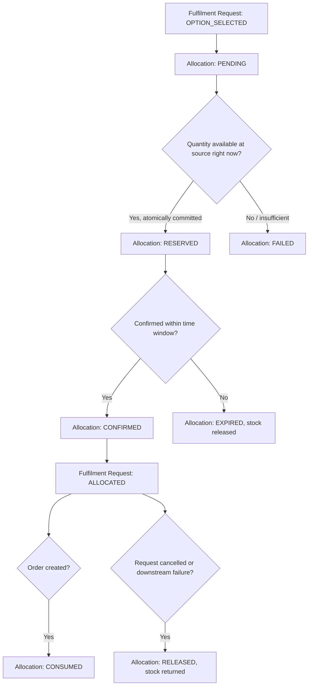

# Allocation Process

## 1. Business meaning

Allocation is the moment a Fulfilment Request converts a *proposal* (a selected Fulfilment Option) into a *commitment* against real stock. It sits strictly between Fulfilment Selection and Order.

Three distinct concepts must never be conflated:

| Term | Meaning |
|---|---|
| **AVAILABLE** | Stock exists and is free to allocate, per the most recent Availability Result (`AVAILABILITY_PROCESS.md`). Nothing is held yet. |
| **RESERVED** | Stock has been soft-held against a specific pending allocation attempt. Not yet guaranteed — see the Allocation state machine (`PROCESS_STATES.md` §B). |
| **ALLOCATED** | Stock is confirmed and committed to this Fulfilment Request. This is the `CONFIRMED` state of an Allocation. Nothing else may consume this quantity. |

## 2. Allocation lifecycle

See `PROCESS_STATES.md` §B for the full state machine (`PENDING → RESERVED → CONFIRMED → CONSUMED`, plus `RELEASED`, `EXPIRED`, `FAILED`). In business terms:

1. **Allocation request** — the platform requests a quantity from the selected source.
2. **Reservation** — the source (or the platform's own reservation layer in front of the source) soft-holds the quantity: `RESERVED`.
3. **Allocation confirmation** — the reservation is confirmed as committed: `CONFIRMED`. This is what the rest of the process calls "ALLOCATED."
4. **Consumption** — once an Order is created referencing this allocation, it moves to `CONSUMED` and is no longer separately actionable (`ORDER_PROCESS.md`).
5. **Allocation failure** — the request could not be reserved at all (e.g., insufficient quantity at the moment of the attempt): `FAILED`.
6. **Partial allocation** — where the source can only cover part of the requested quantity, the business must decide (per HCME policy, currently UNKNOWN) whether a partial allocation is acceptable or whether it should fail outright and fall back to a different Fulfilment Option (potentially a split option — see `FULFILMENT_PROCESS.md`). This document defines the capability to represent a partial allocation; it does not mandate accepting one by default.
7. **Cancellation / release** — if the Fulfilment Request is cancelled, or a downstream stage fails, any `RESERVED` or `CONFIRMED` allocation tied to it must be explicitly released back to available stock: `RELEASED`.
8. **Expiry** — a `RESERVED` allocation that is not confirmed within an agreed time window lapses automatically: `EXPIRED`, and the held quantity returns to available stock. The exact time window is a TO-BE business decision, not invented here.

## 3. The production requirement: no double-allocation

> **Two simultaneous users must not be able to successfully allocate the same final unit of inventory.**

This is a business invariant, not a technology choice (the mechanism — locking, optimistic concurrency, a queue, etc. — is a Phase 2 decision). At the business level, the requirement means:

- An allocation attempt must check and commit against the *current* available quantity as a single, indivisible business step — not "check, then later commit" with a gap where another request could slip in.
- If two requests race for the last unit, exactly one may reach `CONFIRMED`; the other must receive a definitive `FAILED` result (or fall back to another source/option), never a silent overcommitment.
- This rule applies per source, since availability is tracked per source (see `AVAILABILITY_PROCESS.md`).

This requirement is listed again as a formal invariant in `BUSINESS_RULES.md`.

## 4. What is deliberately NOT defined here

Per the Phase 0 research, no Hitachi-specific allocation priority or VOR (vehicle-off-road)/emergency policy is confirmed (see `HCME_CONFIRMED_VS_UNKNOWN.md`). This document does **not** invent one. It defines only the system capability a future policy would need:

- The ability to tag a Fulfilment Request with a priority/urgency indicator (value set and meaning: TO-BE).
- The ability for an allocation decision to consider that indicator when two requests compete for the same stock (mechanism: TO-BE, Phase 2).
- The ability to record which policy (if any) applied to a given allocation decision, for audit purposes.

Whether HCME wants such a policy at all, and what its rules should be, is routed to `HCME_BUSINESS_QUESTIONS.md`.

## 5. Process flow

## 6. Failure/exception summary (full detail in `FAILURE_AND_EXCEPTION_CASES.md`)

| Case | Handling |
|---|---|
| Allocation fails (insufficient stock at commit time) | Allocation → `FAILED`; Fulfilment Request returns to Fulfilment Selection to try another option, or → `FAILED` if none remain. |
| Allocation expires | Allocation → `EXPIRED`; stock released; user prompted to re-select/re-allocate. |
| Partial allocation | Represented explicitly (quantity allocated vs. requested); business decision (TO-BE) on whether to accept, or reject and retry. |
| Cancellation | Any `RESERVED`/`CONFIRMED` allocation is released before the Fulfilment Request reaches `CANCELLED`. |
