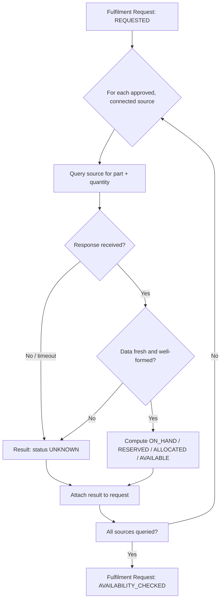

# Availability Process

Answers one question: **"Where can this part be fulfilled from?"**

This is deliberately separate from Fulfilment (`FULFILMENT_PROCESS.md`), which answers "how do we get it there?". Availability never selects a winner and never computes transport — it only reports what it can find, honestly.

## 1. Sources considered

Per the Phase 0 research (`HCME_CONFIRMED_VS_UNKNOWN.md`), HCME's confirmed supply-chain structure is tiered: dealer stock → regional depot → Central Parts Depot, plus a Remanufactured source tier where applicable. The process is designed to query any of these tiers, but:

> **Not every source is assumed available to the future system.** Only sources HCME has approved and technically connected are queried. A source that is not connected is simply not queried — it does not appear as a `0` result, it does not appear at all, or it appears explicitly flagged as not-yet-connected if the business wants that visibility.

| Source | Status |
|---|---|
| Dealer stock | Confirmed to exist as a concept (dealers hold stock); whether it is digitally queryable is UNKNOWN. |
| Regional depot | Confirmed to exist (4 depots, global network); which depot(s) serve Europe and whether they are queryable is UNKNOWN. |
| Central depot | Confirmed to exist (Tsukuba, Japan, 24/7/365, AEO customs-certified); queryability by this platform is UNKNOWN. |
| Other approved supply sources | Not defined in Phase 0 research; left as an open category for HCME to define. |
| Remanufactured source | Confirmed as a part tier (Hitachi offers Genuine, Remanufactured, and Selected parts); whether it is a separately queryable source is UNKNOWN. |

## 2. The Availability Result

For every source queried, the process produces one Availability Result:

| Field | Description |
|---|---|
| Source | Which tier/source this result came from (dealer, regional, central, remanufactured, other). |
| Location | The specific location identifier within that source (e.g., which depot, which dealer branch). |
| Part | The part number this result concerns. |
| On-hand quantity | Physical quantity present at the source, where available. |
| Reserved quantity | Quantity soft-held against pending allocations. |
| Allocated quantity | Quantity already committed to confirmed allocations. |
| Available quantity | On-hand minus reserved minus allocated — the quantity that could still be allocated. |
| Inventory timestamp | When this figure was true, as reported by the source. |
| Inventory source/system | Which system supplied this figure (recorded even when UNKNOWN as a named system — see below). |
| Confidence/status | See §3. |

## 3. Status model

Every Availability Result carries exactly one status, from a fixed vocabulary:

| Status | Meaning |
|---|---|
| `ON_HAND` | Physical stock is confirmed present at this source. |
| `RESERVED` | Stock exists but is soft-held for another pending request. |
| `ALLOCATED` | Stock exists but is already committed to a confirmed allocation. |
| `AVAILABLE` | Stock is confirmed free to allocate (on-hand, not reserved, not allocated). |
| `UNKNOWN` | The source could not be queried, did not respond, or returned data the platform cannot trust (stale beyond an agreed threshold, malformed, or simply absent). |

### The rule that matters most

> **Missing inventory data must never be automatically interpreted as zero stock.** A source that cannot be reached, does not respond, or returns nothing produces an Availability Result with status `UNKNOWN` and no quantity claim — never an implicit `0`. Treating "no data" as "no stock" would silently and incorrectly remove a real fulfilment option from consideration. Downstream stages (`FULFILMENT_PROCESS.md`) must treat `UNKNOWN` sources as "cannot currently offer as an option" — not as "confirmed unavailable."

## 4. Process flow

## 5. Failure/exception handling (summary; full detail in `FAILURE_AND_EXCEPTION_CASES.md`)

| Case | Handling |
|---|---|
| Inventory source unavailable (no response) | Result recorded as `UNKNOWN` for that source; other sources proceed independently. |
| Inventory data stale (older than an agreed freshness threshold — threshold itself is a TO-BE business decision) | Result recorded as `UNKNOWN`, with the stale timestamp preserved for transparency. |
| Requested quantity exceeds availability at a single source | Result still recorded honestly (actual available quantity shown); the request is not blocked — see partial availability. |
| Partial availability across multiple sources | Each source reports its own honest result; Fulfilment Options (next stage) may combine multiple sources if the business allows split fulfilment — that combination logic lives in `FULFILMENT_PROCESS.md`, not here. |
| No sources return any usable result | Fulfilment Request proceeds to `AVAILABILITY_CHECKED` with all results `UNKNOWN`; Fulfilment Options stage will have nothing viable to offer — see `FAILURE_AND_EXCEPTION_CASES.md`. |

## 6. What this stage explicitly does not do

- It does not decide which source to use — that is Fulfilment Selection (Stage 4).
- It does not compute transport, cost, or time — that is Fulfilment Options (Stage 3).
- It does not reserve or allocate stock — that is Allocation (Stage 5).
- It does not assume any specific inventory system exists — see `HCME_CONFIRMED_VS_UNKNOWN.md`.
