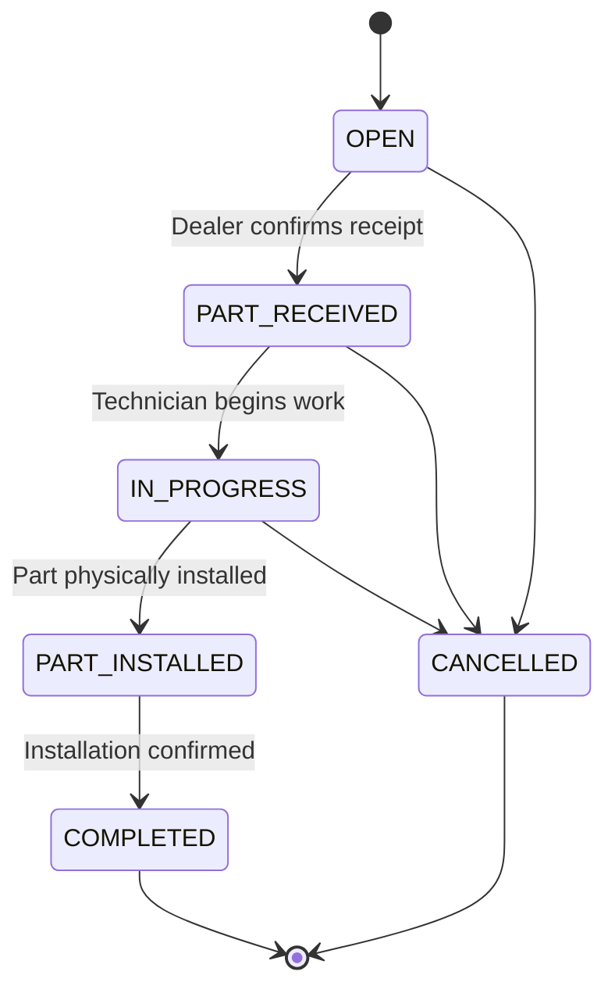

# Dealer, Service/Installation & Close

Covers Stages 8, 9 and 10 of `HCME_PARTS_FULFILMENT_PROCESS.md`.

## 1. Dealer — receiving

Once a Shipment reaches `DELIVERED` (see `SHIPMENT_PROCESS.md`), the Dealer Branch confirms physical receipt.

| Step | Detail |
|---|---|
| Receipt confirmation | The Dealer Branch confirms the shipment arrived, and records quantity and condition against what the Order specified. |
| Match check | Received quantity/part is compared to the Order; a mismatch is a failure case (see `FAILURE_AND_EXCEPTION_CASES.md`). |
| Service Job creation | On confirmed, matching receipt, a Service Job is created: `OPEN → PART_RECEIVED`. |
| Customer coordination | The Dealer Branch coordinates scheduling with the customer for installation/service. |

The Dealer is treated throughout as a first-class business entity — see `ACTORS_AND_RESPONSIBILITIES.md` §3 for its full role and the data fields this process requires (most of which are currently UNKNOWN and flagged as such).

## 2. Service / Installation

| | |
|---|---|
| **Entry condition** | Service Job is `PART_RECEIVED`. |
| **Actor** | Technician, at the Dealer Branch. |
| **Fields tracked** | Machine, Dealer, Order, Part, Technician, service status, start time, completion time, installation confirmation, notes/evidence (where required). |
| **Flow** | `PART_RECEIVED → IN_PROGRESS` (technician begins work) `→ PART_INSTALLED` (part physically fitted) `→ COMPLETED` (work confirmed done). |
| **Scope discipline** | This process defines only what is needed to know a part was received, installed, and the job closed. It does not introduce scheduling systems, technician skill-matching, warranty claims processing, or other service-management features beyond this workflow's needs — those are explicitly out of scope for Phase 1. |



## 3. Close

### The exact closing condition

> The Fulfilment Request moves to `COMPLETED` **if and only if** its Shipment is `DELIVERED` **and** its Service Job is `COMPLETED`.

Both conditions are required — a delivered-but-not-installed part does not close the request, and (by construction) a Service Job cannot reach `COMPLETED` before the part was received, which itself cannot happen before delivery. This makes Close a deterministic consequence of the two upstream state machines, not a separate decision point.

### The full trace recorded at Close

```
Machine/context
  ↓
Part
  ↓
Availability
  ↓
Fulfilment
  ↓
Allocation
  ↓
Order
  ↓
Shipment
  ↓
Dealer
  ↓
Service
  ↓
Part Installed
  ↓
Closed
```

Every link in this trace is a reference, not a copy: the closed Fulfilment Request points to its Availability Results, its chosen Fulfilment Option, its Allocation, its Order, its Shipment, and its Service Job, so the complete history can be reconstructed from a single closed record.

### What Close does not do

- It does not trigger any new process (no automatic re-order, no automatic follow-up) — those would be new business decisions, not part of this scope.
- It does not depend on any UNKNOWN external system — closing is entirely internal to the platform's own state.
