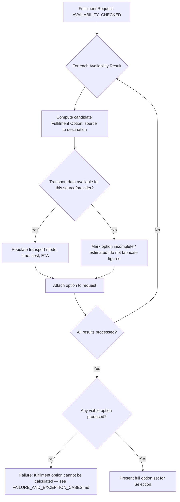

# Fulfilment Process (Options + Selection)

Availability answers "where is the part?" (`AVAILABILITY_PROCESS.md`). Fulfilment answers **"how can we get it to the destination?"** — and then lets the appropriate party choose. This document covers Stage 3 (Fulfilment Options) and Stage 4 (Fulfilment Selection) from `HCME_PARTS_FULFILMENT_PROCESS.md`.

## 1. Fulfilment Options — computing candidates

A Fulfilment Option is a candidate way to move the part from one Availability Result's source to the request's destination. The stage computes the full set of viable candidates; it does not pick one.

### Fulfilment Option fields

| Field | Description |
|---|---|
| Source | Which Availability Result this option fulfils from. |
| Destination | The request's destination (typically a Dealer Branch). |
| Transport mode | E.g., road, courier, internal transfer — not assumed beyond what an approved provider can report; UNKNOWN where no provider integration exists. |
| Provider | The logistics provider or internal transfer mechanism, where known. |
| Processing time | Time to prepare the part for dispatch at the source. |
| Transit time | Time in transport from source to destination. |
| ETA | Estimated arrival, derived from processing + transit time. |
| Transport cost | Cost of the transport leg, where available. |
| Total cost | Transport cost plus any other confirmed cost components (pricing itself is resolved later, at Order — see `ORDER_PROCESS.md`). |
| Constraints | Anything that limits this option (e.g., minimum order quantity at the source, partial-quantity-only, customs/AEO considerations for cross-border movement). |
| Availability confidence | Carried over from the source Availability Result's status (`ON_HAND` / `AVAILABLE` results support a higher-confidence option than `UNKNOWN` ones — see below). |

### Rule: an `UNKNOWN`-status source does not produce a confident option

An Availability Result with status `UNKNOWN` (see `AVAILABILITY_PROCESS.md` §3) may still be offered as a candidate option, but it must be clearly marked low-confidence/unconfirmed rather than silently omitted or silently treated as equal to a confirmed `AVAILABLE` source. This preserves the "missing data ≠ zero stock" principle through to the option a human sees.

### Rule: cheapest does not automatically win

This stage produces a **set**, not a decision. No default sort or auto-selection logic collapses the set to one option. The business/user makes that choice at Fulfilment Selection.

### Multi-source (split) fulfilment

Where a single source cannot cover the full requested quantity but multiple sources together can, the platform may present a split option (e.g., "60% from Dealer Branch stock, arriving today; 40% from Regional Depot, arriving in 3 days") alongside single-source options. Whether HCME's business wants split fulfilment enabled by default, or only as an explicit fallback, is a TO-BE decision — see `HCME_BUSINESS_QUESTIONS.md`. This document defines the *capability*; it does not mandate the policy.

## 2. Fulfilment Options process flow

## 3. Fulfilment Selection

| | |
|---|---|
| **Who selects** | Customer or Dealer — which party is appropriate is context-dependent (e.g., a business account might let the dealer choose on the customer's behalf) and is an open business question — see `HCME_BUSINESS_QUESTIONS.md`. This document does not assume one answer. |
| **What is selected** | Exactly one Fulfilment Option from the set produced above. |
| **Validation at selection time** | The selected option must still be valid — if the underlying Availability Result has changed (e.g., stock consumed by another request) between presentation and selection, the option is re-validated before proceeding; if it is no longer valid, Fulfilment Options is re-run. See `FAILURE_AND_EXCEPTION_CASES.md`. |
| **Output** | The selected Fulfilment Option is attached to the Fulfilment Request, which moves to `OPTION_SELECTED` and proceeds to Allocation (`ALLOCATION_PROCESS.md`). |

## 4. What this stage explicitly does not do

- It does not reserve or commit stock — a Fulfilment Option is a proposal, not a hold. Reservation only happens at Allocation.
- It does not resolve price — total cost here is transport-side only; final pricing is resolved at Order (`ORDER_PROCESS.md`), consistent with the Phase 0 finding that OEM pricing is dealer/account-dependent, not a fixed attribute.
- It does not assume a specific carrier or logistics system — see `HCME_CONFIRMED_VS_UNKNOWN.md`.
