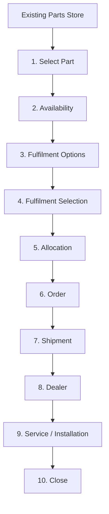

# HCME Parts-to-Service Fulfilment Process

**Phase:** 1 — Business Process Design (no application code, no schema, no technology choices)
**Scope:** Select Part → Availability → Fulfilment Options → Fulfilment Selection → Allocation → Order → Shipment → Dealer → Service/Installation → Close

This is the end-to-end specification. Each stage below is detailed further in its own document (`AVAILABILITY_PROCESS.md`, `FULFILMENT_PROCESS.md`, `ALLOCATION_PROCESS.md`, `ORDER_PROCESS.md`, `SHIPMENT_PROCESS.md`, `DEALER_SERVICE_PROCESS.md`); this document is the map that ties them together and is the one to read first.

## The journey

## Future inputs (not a Phase 1 dependency)

Two things are confirmed to exist in the Phase 0 research but are deliberately **not** wired into this workflow:

- **ConSite** — confirmed to link machine maintenance alerts to a dealer, who then manually reviews and prepares/orders parts.
- **Telematics API (ISO 15143-3 / AEMP 2.0)** — confirmed to exist publicly; auth model and pricing UNKNOWN.

Both are documented here only as a **possible future upstream trigger into Select Part** (a machine signal could one day suggest "this part may be needed"). Neither may become a dependency of any stage below: no stage may require telemetry data to function, and no stage may automatically allocate or order based on a telemetry signal. This restriction is deliberate per `PHASE_1_DECISIONS.md` §3.

---

## Stage 1 — Select Part

| | |
|---|---|
| **Purpose** | Capture a fully-specified, validated request to fulfil a specific part, in the context of a specific machine/customer/destination, starting from the existing Parts Store. |
| **Actor** | Customer (acts); Platform (validates). |
| **Trigger** | Customer selects a part in the existing Parts Store and proceeds into the fulfilment flow. |
| **Input** | Part number, quantity, machine/context (where available), customer, destination, required-by date (where applicable). |
| **Business decision** | Is this part identifiable, compatible with the stated machine/context, and orderable at all? (Not: is it in stock — that is Availability's question.) |
| **Process** | 1. Resolve the part identification against the catalogue the Parts Store already uses (no redesign of that catalogue). 2. Validate compatibility/fitment where a machine/context is given. 3. Validate the part is orderable (not discontinued/blocked). 4. Capture quantity, customer, destination, and required-by date. 5. Create the Fulfilment Request. |
| **Output** | A validated Fulfilment Request in state `REQUESTED`, carrying: part number, quantity, machine/context, customer, destination, required-by date. |
| **Next state** | Fulfilment Request `DRAFT` → `REQUESTED`. |
| **Failure/exception cases** | Part does not exist; part is not orderable; fitment is uncertain. See `FAILURE_AND_EXCEPTION_CASES.md`. |
| **Information required** | Part number, quantity, destination. Machine/context and required-by date only where applicable to the request. |
| **Information currently unknown** | The authoritative parts master / compatibility (fitment) data source is not confirmed (see `HCME_CONFIRMED_VS_UNKNOWN.md` and `HCME_BUSINESS_QUESTIONS.md`). This process assumes the existing Parts Store already performs identification and fitment validation and does not redesign it — see §Scope note below. |

**Scope note:** the existing Parts Store is not being redesigned. This stage describes what the downstream fulfilment process needs to receive from it (part, quantity, context, customer, destination, required-by date) — it does not specify how the Parts Store itself should look or work.

---

## Stage 2 — Availability

| | |
|---|---|
| **Purpose** | Answer "where can this part be fulfilled from?" across the sources the platform is authorised to query. |
| **Actor** | Platform (queries); External Enterprise Systems (supply inventory data, where available). |
| **Trigger** | Fulfilment Request reaches `REQUESTED`. |
| **Input** | Part number, quantity requested. |
| **Business decision** | Which sources to query (dealer stock, regional depot, central depot, other approved supply sources, remanufactured source where applicable) — not every source is assumed available to the future system; only sources HCME has approved and connected are queried. |
| **Process** | Query each approved source for the part. For each source, record an Availability Result (source, location, part, on-hand/reserved/allocated/available quantity, inventory timestamp, inventory source/system, confidence status). See `AVAILABILITY_PROCESS.md` for the full detail, including the `ON_HAND / RESERVED / ALLOCATED / AVAILABLE / UNKNOWN` status model. |
| **Output** | One or more Availability Results attached to the Fulfilment Request. |
| **Next state** | Fulfilment Request `REQUESTED` → `AVAILABILITY_CHECKED`. |
| **Failure/exception cases** | Inventory unavailable at a source; inventory data stale; inventory source unavailable; requested quantity exceeds availability; partial availability exists. See `FAILURE_AND_EXCEPTION_CASES.md`. |
| **Information required** | Per source: on-hand quantity, reserved quantity, allocated quantity, available quantity, inventory timestamp, inventory source/system, confidence/status. |
| **Information currently unknown** | The authoritative inventory source(s) for each tier (dealer, regional, central) are not confirmed. See `HCME_CONFIRMED_VS_UNKNOWN.md`. **Missing data from a source must never be interpreted as zero stock** — it is recorded as `UNKNOWN` (see `AVAILABILITY_PROCESS.md`). |

---

## Stage 3 — Fulfilment Options

| | |
|---|---|
| **Purpose** | Answer "how can we get the part to the destination?" — separate from *where* it is (Availability). |
| **Actor** | Platform (computes); External Enterprise Systems (supply transport cost/time where available). |
| **Trigger** | Fulfilment Request reaches `AVAILABILITY_CHECKED` with at least one Availability Result. |
| **Input** | Availability Results, destination, required-by date. |
| **Business decision** | Which source(s) can plausibly serve this request, and by what transport mode/provider — computed as a set of candidate options, without picking a winner. Cheapest does not automatically win (see `FULFILMENT_PROCESS.md`). |
| **Process** | For each viable (source, transport) combination, compute a Fulfilment Option: source, destination, transport mode, provider, processing time, transit time, ETA, transport cost, total cost, constraints, availability confidence. Present the full set to the next stage. |
| **Output** | A set of Fulfilment Options attached to the Fulfilment Request. |
| **Next state** | Fulfilment Request remains `AVAILABILITY_CHECKED` until a selection is made (see Stage 4). |
| **Failure/exception cases** | Fulfilment option cannot be calculated (e.g., no transport data available for a source); transport provider unavailable. See `FAILURE_AND_EXCEPTION_CASES.md`. |
| **Information required** | Per option: source, destination, transport mode, provider, processing time, transit time, ETA, transport cost, total cost, constraints, availability confidence. |
| **Information currently unknown** | No carrier, transport-cost source, or logistics-provider integration is confirmed for HCME (see `HCME_CONFIRMED_VS_UNKNOWN.md`). Where such data is unavailable, an option is presented as incomplete/estimated rather than fabricated — see `FULFILMENT_PROCESS.md`. |

---

## Stage 4 — Fulfilment Selection

| | |
|---|---|
| **Purpose** | Let the appropriate party choose a valid Fulfilment Option. |
| **Actor** | Customer or Dealer (which one is context-dependent — see `HCME_BUSINESS_QUESTIONS.md`). |
| **Trigger** | Fulfilment Options are available for review. |
| **Input** | The set of Fulfilment Options from Stage 3. |
| **Business decision** | Which option best fits cost, time, and constraints for this request. Not automated to "cheapest" or "fastest" by default. |
| **Process** | Present all valid options with their comparison data; capture the selection. |
| **Output** | A selected Fulfilment Option attached to the Fulfilment Request. |
| **Next state** | Fulfilment Request `AVAILABILITY_CHECKED` → `OPTION_SELECTED`. |
| **Failure/exception cases** | Selected option becomes invalid between presentation and selection (e.g., availability changed) — re-run Fulfilment Options. See `FAILURE_AND_EXCEPTION_CASES.md`. |
| **Information required** | The selected option's identifier and the actor who made the selection. |
| **Information currently unknown** | Whether HCME wants the customer or the dealer (or both, contextually) to be able to make this selection is a TO-BE decision — see `HCME_BUSINESS_QUESTIONS.md`. |

---

## Stage 5 — Allocation

| | |
|---|---|
| **Purpose** | Convert a selected option's source and quantity into a committed reservation of stock, safely under concurrent demand. |
| **Actor** | Platform. |
| **Trigger** | Fulfilment Request reaches `OPTION_SELECTED`. |
| **Input** | Selected source, part, quantity. |
| **Business decision** | Can this quantity be committed against this source right now? (No Hitachi-specific VOR/priority policy is assumed — see `ALLOCATION_PROCESS.md`.) |
| **Process** | Request allocation against the source; the platform must guarantee that two simultaneous requests cannot both successfully allocate the same final unit (see `ALLOCATION_PROCESS.md` for the concurrency requirement, and `BUSINESS_RULES.md` for the invariant). On success, the Allocation moves through `RESERVED` → `CONFIRMED`. |
| **Output** | A confirmed Allocation referencing the Fulfilment Request, source, and quantity. |
| **Next state** | Fulfilment Request `OPTION_SELECTED` → `ALLOCATION_PENDING` → `ALLOCATED` (or `FAILED`). |
| **Failure/exception cases** | Allocation fails; allocation expires; partial allocation; cancellation/release. See `ALLOCATION_PROCESS.md` and `FAILURE_AND_EXCEPTION_CASES.md`. |
| **Information required** | Source, part, quantity, reservation timestamp, allocation confirmation timestamp. |
| **Information currently unknown** | Any Hitachi-specific allocation priority or VOR/emergency policy — UNKNOWN, not invented. Only the system capability to support a future policy is defined here. See `HCME_CONFIRMED_VS_UNKNOWN.md`. |

---

## Stage 6 — Order

| | |
|---|---|
| **Purpose** | Formally create the order once allocation is confirmed. |
| **Actor** | Platform (creates); HCME/approved pricing source (supplies price — see `ORDER_PROCESS.md`). |
| **Trigger** | Allocation reaches `CONFIRMED`. |
| **Input** | Confirmed Allocation, customer, dealer, destination, required-by date, selected Fulfilment Option. |
| **Business decision** | What price applies to this customer/order? Pricing is **not** a fixed part attribute — it is resolved from an approved pricing source/rule (dealer/account/login-dependent, per Phase 0 industry pattern). See `ORDER_PROCESS.md`. |
| **Process** | Resolve price, shipping cost and tax from approved sources; assemble the order (customer, dealer, part, quantity, source, fulfilment option, price, shipping cost, tax, total, destination, required-by date, reference to the Allocation); create the order. |
| **Output** | An Order in status `CREATED`, referencing the Allocation (which moves to `CONSUMED`). |
| **Next state** | Fulfilment Request `ALLOCATED` → `ORDERED`. |
| **Failure/exception cases** | Order creation fails; pricing unavailable. See `FAILURE_AND_EXCEPTION_CASES.md`. |
| **Information required** | Customer, dealer, part, quantity, source, fulfilment option, price, shipping cost, tax, total, destination, required-by date, allocation reference, order status. |
| **Information currently unknown** | The system of record for orders, and the approved pricing source, are not confirmed. See `HCME_CONFIRMED_VS_UNKNOWN.md`. |

---

## Stage 7 — Shipment

| | |
|---|---|
| **Purpose** | Move the allocated, ordered part from source to destination, with visibility. |
| **Actor** | Logistics Provider (transports); Platform (records state). |
| **Trigger** | Order reaches `FULFILMENT` (accepted for preparation at the source). |
| **Input** | Order, selected Fulfilment Option (transport mode/provider). |
| **Business decision** | None new — executes the transport chosen in Stage 4. |
| **Process** | Create Shipment (`CREATED`); dispatch (`DISPATCHED`); track transit events (`IN_TRANSIT`); confirm delivery (`DELIVERED`). See `SHIPMENT_PROCESS.md` and the Shipment state machine in `PROCESS_STATES.md`. |
| **Output** | A Shipment record with carrier/provider, service level, tracking number, origin, destination, ETA, status, and event history. |
| **Next state** | Fulfilment Request `ORDERED` → `FULFILMENT` → `SHIPPED` → `DELIVERED`. |
| **Failure/exception cases** | Shipment creation fails; shipment delayed; shipment lost; dealer rejects/does not receive shipment; part damaged. See `FAILURE_AND_EXCEPTION_CASES.md`. |
| **Information required** | Carrier/provider, service level, tracking number, origin, destination, ETA, status, events, delivery confirmation. |
| **Information currently unknown** | No carrier or shipment-tracking system is confirmed for HCME. The process is designed so any approved logistics provider can be integrated later. See `HCME_CONFIRMED_VS_UNKNOWN.md`. |

---

## Stage 8 — Dealer

| | |
|---|---|
| **Purpose** | Receive the shipped part and coordinate with the customer for service. |
| **Actor** | Dealer Branch. |
| **Trigger** | Shipment reaches `DELIVERED`. |
| **Input** | Shipment, Order. |
| **Business decision** | Does the received shipment match the order (quantity, part, condition)? |
| **Process** | Confirm receipt; open a Service Job (`OPEN` → `PART_RECEIVED`); coordinate scheduling with the customer. See `DEALER_SERVICE_PROCESS.md`. |
| **Output** | Confirmed receipt; a Service Job in `PART_RECEIVED`. |
| **Next state** | Service Job `OPEN` → `PART_RECEIVED`. |
| **Failure/exception cases** | Dealer rejects/does not receive shipment; part is damaged on arrival. See `FAILURE_AND_EXCEPTION_CASES.md`. |
| **Information required** | Branch identity, receipt confirmation, receipt timestamp, condition notes. |
| **Information currently unknown** | Dealer/branch master data (identifier, address, capabilities) is not confirmed — see `ACTORS_AND_RESPONSIBILITIES.md` §3 and `HCME_CONFIRMED_VS_UNKNOWN.md`. |

---

## Stage 9 — Service / Installation

| | |
|---|---|
| **Purpose** | Install the part on the machine and confirm the work is done. |
| **Actor** | Technician (at Dealer Branch). |
| **Trigger** | Service Job reaches `PART_RECEIVED`. |
| **Input** | Service Job, part, machine. |
| **Business decision** | Can the part be installed as received? (See failure case: part cannot be installed.) |
| **Process** | Assign technician; begin work (`IN_PROGRESS`); install part (`PART_INSTALLED`); confirm completion (`COMPLETED`). Capture start time, completion time, installation confirmation, and notes/evidence if required. |
| **Output** | A completed Service Job. |
| **Next state** | Service Job `PART_RECEIVED` → `IN_PROGRESS` → `PART_INSTALLED` → `COMPLETED`. |
| **Failure/exception cases** | Part cannot be installed; service job cancelled. See `FAILURE_AND_EXCEPTION_CASES.md`. |
| **Information required** | Machine, dealer, order, part, technician, service status, start time, completion time, installation confirmation, notes/evidence. |
| **Information currently unknown** | Whether a dedicated service-job system exists at HCME beyond ConSite (which is confirmed only as a telematics/alerts tool, not a job-management system) is unconfirmed. See `HCME_CONFIRMED_VS_UNKNOWN.md`. |

---

## Stage 10 — Close

| | |
|---|---|
| **Purpose** | Formally close the Fulfilment Request once the full trace is complete. |
| **Actor** | Platform. |
| **Trigger** | Shipment is `DELIVERED` **and** Service Job is `COMPLETED`. |
| **Input** | Shipment status, Service Job status. |
| **Business decision** | None — closing is a deterministic consequence of both conditions being met; see `DEALER_SERVICE_PROCESS.md` §Close for the exact rule. |
| **Process** | Verify both conditions; mark the Fulfilment Request `COMPLETED`; the full trace (Machine/context → Part → Availability → Fulfilment → Allocation → Order → Shipment → Dealer → Service → Part Installed → Closed) becomes the permanent record. |
| **Output** | A closed Fulfilment Request. |
| **Next state** | Fulfilment Request `DELIVERED` → `COMPLETED`. |
| **Failure/exception cases** | None specific to Close itself — a request that cannot reach both conditions remains open or is separately cancelled/failed upstream. |
| **Information required** | Shipment `DELIVERED` timestamp, Service Job `COMPLETED` timestamp, close timestamp. |
| **Information currently unknown** | None — Close is fully defined by this process; it depends only on internal state, not on any external unconfirmed system. |

---

See `PROCESS_STATES.md` for the full state machines, `BUSINESS_RULES.md` for cross-cutting rules, and `FAILURE_AND_EXCEPTION_CASES.md` for every exception path in one place.
