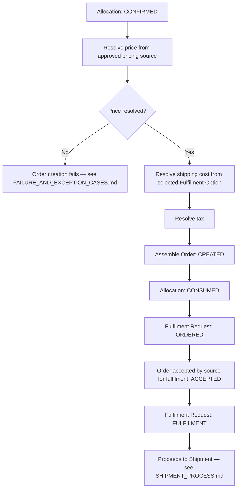

# Order Process

## 1. When an order is created

An Order is created only after Allocation reaches `CONFIRMED` (see `ALLOCATION_PROCESS.md`). This ordering is deliberate: HCME never creates a formal order against stock that has not been safely committed, avoiding the risk of an order that cannot actually be fulfilled.

## 2. Order fields

| Field | Description |
|---|---|
| Customer | From the Fulfilment Request (Select Part stage). |
| Dealer | The dealer associated with the selected Fulfilment Option/destination, where applicable. |
| Part | Part number and description. |
| Quantity | The confirmed allocated quantity (may be less than originally requested if a partial allocation was accepted — see `ALLOCATION_PROCESS.md`). |
| Source | The source the allocation was made against. |
| Fulfilment option | The selected transport/provider option from `FULFILMENT_PROCESS.md`. |
| Price | Resolved at order time from an approved pricing source — see §3. |
| Shipping cost | From the selected Fulfilment Option's transport cost. |
| Tax | Resolved per applicable rules (jurisdiction, customer type) — source UNKNOWN, see `HCME_CONFIRMED_VS_UNKNOWN.md`. |
| Total | Price + shipping cost + tax. |
| Destination | From the Fulfilment Request. |
| Required-by date | From the Fulfilment Request (Select Part stage). |
| Order status | See §4. |
| Allocation reference | Links back to the specific Allocation this order consumes. |

## 3. Pricing is not a fixed part attribute

The Phase 0 research is explicit and consistent across every OEM studied (Hitachi, Caterpillar, Komatsu): **parts pricing is not publicly published and is dealer/account/login-dependent.** This process treats price accordingly:

- Price is **resolved at order time** from an approved pricing source/rule — never stored as a static attribute on the Part itself.
- The specific pricing source/system that will supply this value is UNKNOWN (see `HCME_CONFIRMED_VS_UNKNOWN.md`) and is not invented here.
- The Order records which pricing resolution produced the price (for audit), even before that source is named.
- If no approved pricing source can resolve a price at order time, order creation fails — see `FAILURE_AND_EXCEPTION_CASES.md` — rather than defaulting to a guessed or cached value.

## 4. Order status

Order status is intentionally minimal at this business-process level (technical order-management detail belongs to Phase 2, once a system of record is confirmed):

| Status | Meaning |
|---|---|
| `CREATED` | The order has been assembled and recorded; corresponds to Fulfilment Request `ORDERED`. |
| `ACCEPTED` | The source has accepted the order for fulfilment; corresponds to Fulfilment Request `FULFILMENT`. |
| `CANCELLED` | The order was cancelled before shipment — see `FAILURE_AND_EXCEPTION_CASES.md` for cancellation rules and the requirement to release the underlying allocation. |

Shipment-related status lives on the Shipment entity, not the Order — see `SHIPMENT_PROCESS.md`.

## 5. Process flow

## 6. Failure/exception summary (full detail in `FAILURE_AND_EXCEPTION_CASES.md`)

| Case | Handling |
|---|---|
| Order creation fails (pricing unavailable, source rejects, or other error) | Order not created; Allocation remains `CONFIRMED` (not yet `CONSUMED`) for a bounded retry window, then released if unresolved — exact window is a TO-BE decision. |
| Customer cancels before shipment | Order → `CANCELLED`; underlying Allocation → `RELEASED`; Fulfilment Request → `CANCELLED`. |

## 7. What this stage explicitly does not do

- It does not invent a pricing engine, price list, or discount rule — see §3.
- It does not assume an ERP or order-management system — the system of record for orders is UNKNOWN (see `HCME_CONFIRMED_VS_UNKNOWN.md`); this document defines the order's business shape, not its technical home.
