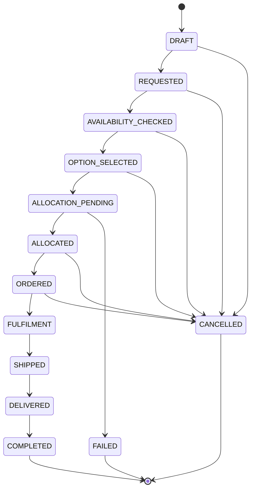
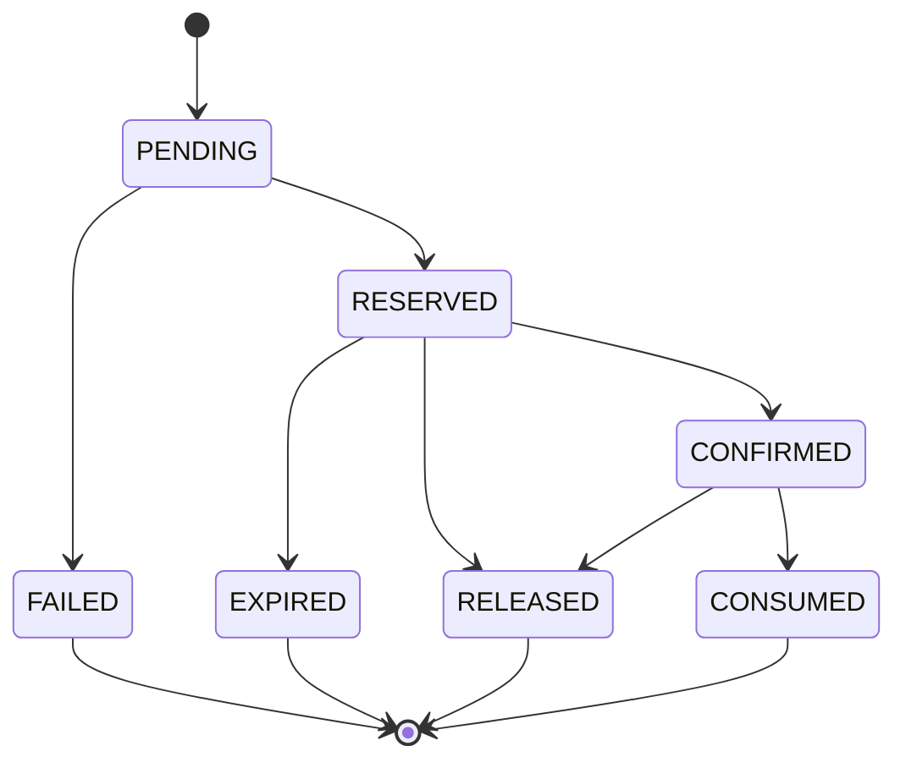
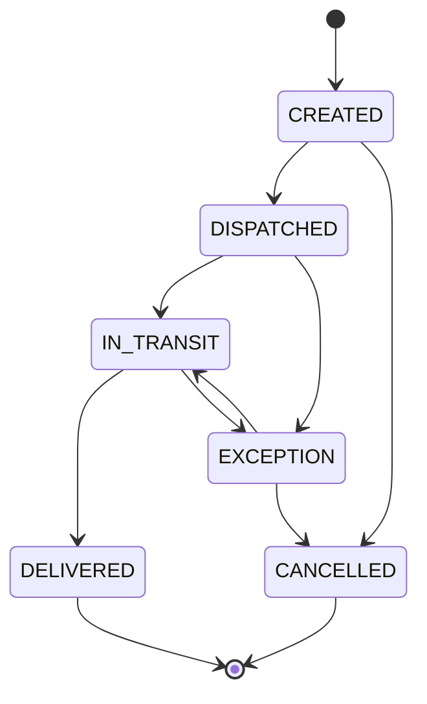
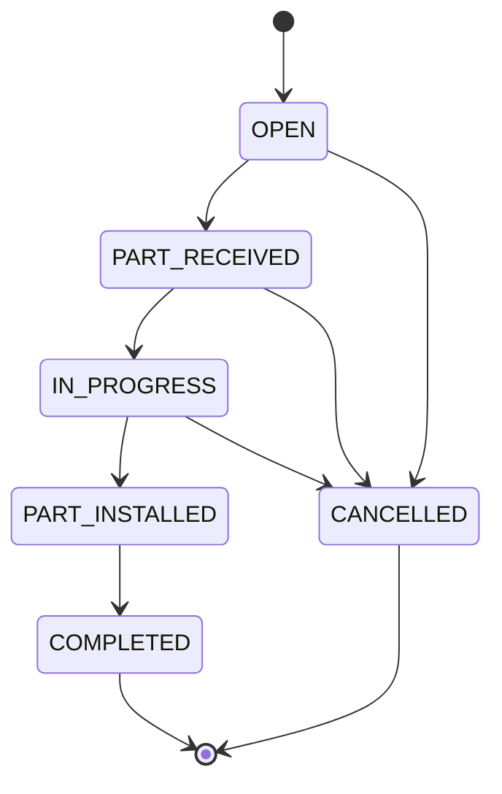
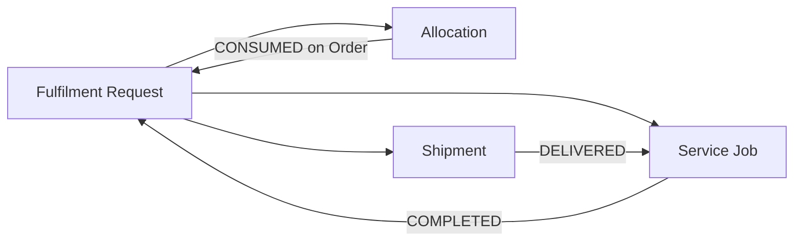

# Process States

Four state machines govern the HCME Parts-to-Service journey. This document is the single source of truth for state names and transitions; other documents reference these states by name rather than redefining them.

## A. Fulfilment Request

The Fulfilment Request is the overall trace tying Select Part → Close together. It is the parent record that Availability, Allocation, Order, Shipment and Service Job all attach to.

| State | Meaning | Entered when | Exit conditions |
|---|---|---|---|
| `DRAFT` | A part has been selected in the Parts Store but the fulfilment journey has not been formally started. | User selects a part and enters the fulfilment flow. | Advances to `REQUESTED`, or abandoned (no formal cancellation needed from `DRAFT`). |
| `REQUESTED` | The business has confirmed intent: part, quantity, destination and (where applicable) required-by date are captured. | Select Part stage completes its validation. | Advances to `AVAILABILITY_CHECKED`, or `CANCELLED`. |
| `AVAILABILITY_CHECKED` | One or more Availability Results have been returned for the request. | Availability stage completes. | Advances to `OPTION_SELECTED` once fulfilment options are computed and one is chosen, or `CANCELLED`. |
| `OPTION_SELECTED` | The user/business has chosen a Fulfilment Option (source + transport). | Select Fulfilment stage completes. | Advances to `ALLOCATION_PENDING`, or `CANCELLED`. |
| `ALLOCATION_PENDING` | An allocation has been requested against the selected source but is not yet confirmed. | Allocation stage begins. | Advances to `ALLOCATED` on success, `FAILED` on allocation failure, or `CANCELLED`. |
| `ALLOCATED` | Stock is confirmed reserved and committed to this request. | Allocation succeeds. | Advances to `ORDERED`, or `CANCELLED` (which must release the allocation — see `ALLOCATION_PROCESS.md`). |
| `ORDERED` | An order has been created referencing the allocation. | Order stage completes. | Advances to `FULFILMENT`, or `CANCELLED` (subject to order-cancellation rules — see `ORDER_PROCESS.md`). |
| `FULFILMENT` | The order is being prepared for shipment at the source. | Order is accepted by the source. | Advances to `SHIPPED`. |
| `SHIPPED` | A shipment has been dispatched. | Shipment stage creates a Shipment in `DISPATCHED` state. | Advances to `DELIVERED`, or remains here through shipment exceptions (see `FAILURE_AND_EXCEPTION_CASES.md`). |
| `DELIVERED` | The shipment has reached the dealer. | Shipment reaches `DELIVERED`. | Advances to `COMPLETED` once the Service Job reaches `COMPLETED` (see Close conditions in `DEALER_SERVICE_PROCESS.md`). |
| `COMPLETED` | The full journey is closed. | Close conditions are met. | Terminal. |
| `FAILED` | The request could not proceed past a required stage (most commonly, allocation failure with no viable alternative). | Any stage's failure path with no recovery. | Terminal, unless the business explicitly restarts a new Fulfilment Request. |
| `CANCELLED` | The customer or business cancelled the request before completion. | Explicit cancellation action. | Terminal. Any held allocation must be released (see `ALLOCATION_PROCESS.md`). |

## B. Allocation

| State | Meaning |
|---|---|
| `PENDING` | An allocation has been requested against a specific source and quantity; not yet checked against live inventory. |
| `RESERVED` | Inventory has been provisionally held (soft reservation) pending confirmation — see `ALLOCATION_PROCESS.md` for the concurrency rule this protects. |
| `CONFIRMED` | The reservation is confirmed as a committed allocation (this is the "ALLOCATED" business state referenced elsewhere). |
| `CONSUMED` | The allocation has been converted into an Order and is no longer separately actionable. |
| `RELEASED` | The allocation was explicitly released (cancellation, failure downstream, manual release) and the held quantity returns to available stock. |
| `EXPIRED` | A time-boxed reservation was not confirmed in time and lapsed automatically; held quantity returns to available stock. |
| `FAILED` | The allocation could not be created at all (e.g., insufficient available quantity at the moment of request). |

## C. Shipment

| State | Meaning |
|---|---|
| `CREATED` | A shipment record exists (source, destination, selected fulfilment option) but has not left the source. |
| `DISPATCHED` | The shipment has left the source location. |
| `IN_TRANSIT` | The shipment is moving toward the destination; tracking events (where available) update against this state. |
| `EXCEPTION` | A delay, loss, damage, or other tracked problem has been flagged (see `FAILURE_AND_EXCEPTION_CASES.md`). May resolve back to `IN_TRANSIT` or terminate in `CANCELLED`. |
| `DELIVERED` | The shipment has been received and confirmed at the destination (Dealer). |
| `CANCELLED` | The shipment was cancelled before or during transit and did not complete. |

## D. Service Job

| State | Meaning |
|---|---|
| `OPEN` | The service job exists (created when the order/shipment is confirmed) but the part has not yet arrived at the dealer. |
| `PART_RECEIVED` | The dealer has confirmed receipt of the part. |
| `IN_PROGRESS` | The technician has started installation/service work. |
| `PART_INSTALLED` | The part has been physically installed; awaiting final confirmation/sign-off. |
| `COMPLETED` | The service job is confirmed complete (see close conditions in `DEALER_SERVICE_PROCESS.md`). |
| `CANCELLED` | The service job was cancelled (e.g., customer cancellation, part damaged beyond use — see `FAILURE_AND_EXCEPTION_CASES.md`). |

## Cross-state-machine relationship

The Fulfilment Request only reaches `COMPLETED` when its linked Shipment is `DELIVERED` **and** its linked Service Job is `COMPLETED` — see `DEALER_SERVICE_PROCESS.md` §Close for the exact conditions.
