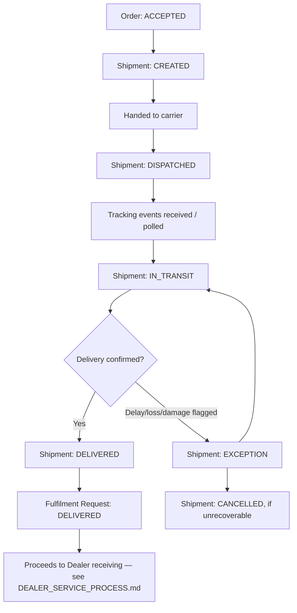

# Shipment Process

## 1. Chain

```
Order (ACCEPTED) → Shipment created → Dispatch → Tracking → Delivery
```

## 2. Shipment fields

| Field | Description |
|---|---|
| Shipment creation | Timestamp and order reference for when the shipment record was created. |
| Carrier/provider | The logistics provider transporting this shipment — UNKNOWN which providers HCME uses (see `HCME_CONFIRMED_VS_UNKNOWN.md`); this process is designed to accept any approved provider. |
| Service level | The transport service tier selected (from the Fulfilment Option — e.g., standard, expedited), where the provider distinguishes one. |
| Tracking number | The provider's reference for this shipment, once dispatched. |
| Origin | The source location (from the Fulfilment Option). |
| Destination | The Dealer Branch (or other confirmed destination). |
| ETA | Estimated delivery, refined as tracking events arrive. |
| Shipment status | See the Shipment state machine, `PROCESS_STATES.md` §C: `CREATED → DISPATCHED → IN_TRANSIT → DELIVERED`, plus `EXCEPTION` and `CANCELLED`. |
| Shipment events | A timestamped history of status changes and tracking updates, as reported by the carrier — recorded whenever the carrier supplies them; absence of events does not imply anything about the shipment's state beyond "no update received." |
| Delivery confirmation | Explicit confirmation (from the carrier and/or the receiving Dealer Branch) that the shipment arrived. |

## 3. Process flow



## 4. Carrier integration is deliberately not designed here

No carrier, transport-management system, or tracking API is named or assumed. Per Phase 0 research, no HCME carrier is publicly confirmed (see `HCME_CONFIRMED_VS_UNKNOWN.md`). The business process is written so that:

- Any approved logistics provider can be integrated later without changing this stage's definition.
- The Shipment entity's fields (§2) are provider-agnostic — they describe what any carrier integration would need to supply, not a specific carrier's data model.
- Tracking is treated as *event-driven and best-effort*: the platform records whatever events a connected carrier supplies; it does not simulate or infer events that were not actually reported.

## 5. Failure/exception summary (full detail in `FAILURE_AND_EXCEPTION_CASES.md`)

| Case | Handling |
|---|---|
| Shipment creation fails | Order remains `ACCEPTED`; retried per a bounded policy (TO-BE); Fulfilment Request does not advance to `SHIPPED`. |
| Shipment delayed | Shipment → `EXCEPTION`; ETA revised where the carrier supplies a new estimate; customer/dealer informed. |
| Shipment lost | Shipment → `EXCEPTION` → `CANCELLED` if confirmed unrecoverable; triggers a business decision (replacement order, refund, etc. — TO-BE, not invented here) routed back through Allocation/Order as a new Fulfilment Request if a replacement is pursued. |
| Dealer rejects/does not receive shipment | See `DEALER_SERVICE_PROCESS.md` and `FAILURE_AND_EXCEPTION_CASES.md`. |
| Part damaged in transit | Shipment → `EXCEPTION`; receiving Dealer Branch records condition at receipt — see `DEALER_SERVICE_PROCESS.md`. |
