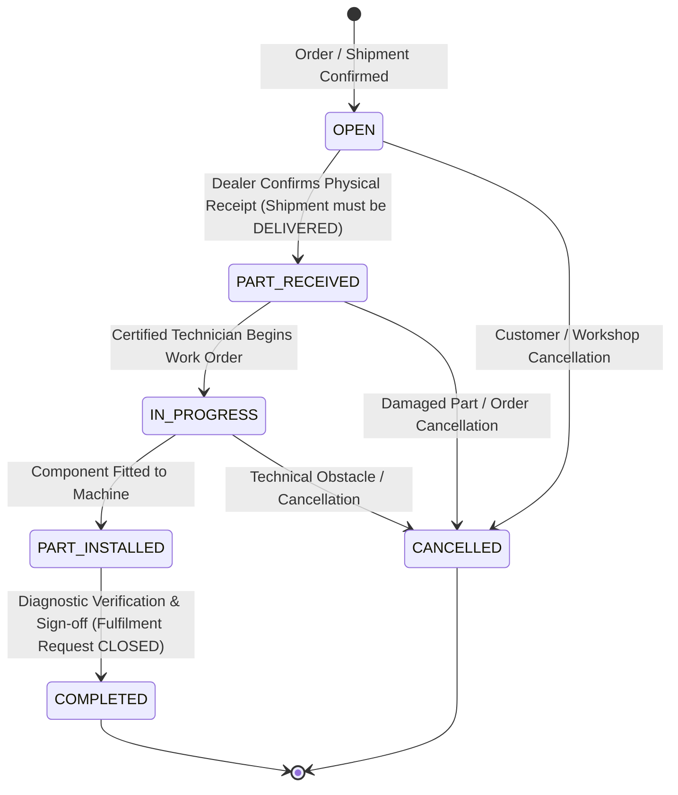
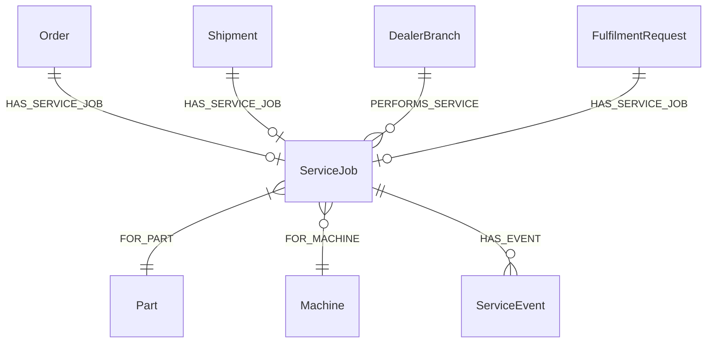

# HCME Europe OEM Parts & Services Platform
# Phase 8 — Implementation Report: Dealer, Service & Close

**Author**: Antigravity (Google DeepMind Team)  
**Date**: September 2026  
**Scope**: Phase 8 Dealer Operations, Service/Installation Lifecycle, and End-to-End Fulfilment Close  
**Target Environment**: HCME Europe (European Parts Centre, Oosterhout, Netherlands)  
**Runtime Database**: Neo4j AuraDB (`neo4j+ssc://fb580139.databases.neo4j.io`)  
**Backend**: Python 3.12 / FastAPI / Async Neo4j Driver  
**Frontend**: React 19 / TypeScript / Vite / Tailwind CSS  

---

## 1. Scope & Objectives

Phase 8 completes the final operational stages of the HCME Europe OEM Parts & Services platform by implementing the **Dealer receiving, service/installation execution, and final request closure** domain:

$$\text{Part} \longrightarrow \text{Availability} \longrightarrow \text{Fulfilment} \longrightarrow \text{Allocation} \longrightarrow \text{Order} \longrightarrow \text{Shipment} \longrightarrow \text{Tracking} \longrightarrow \text{Dealer} \longrightarrow \text{Service Job} \longrightarrow \text{Part Received} \longrightarrow \text{Installation} \longrightarrow \text{Service Completed} \longrightarrow \text{CLOSE}$$

### Core Requirements Met:
1. **Neo4j AuraDB as the Single Source of Truth**: All runtime entities (`ServiceJob`, `ServiceEvent`, `DealerBranch`, `Order`, `Shipment`, `Part`, `Machine`, `FulfilmentRequest`) reside in AuraDB. No PostgreSQL, SQLite application database, or in-memory mock state was introduced.
2. **Strict Business Rule Enforcement**:
   - `receive_part` requires the linked shipment to be in `DELIVERED` status per `DEALER_SERVICE_PROCESS.md` §1.
   - Transitions strictly follow the documented state machine: `OPEN → PART_RECEIVED → IN_PROGRESS → PART_INSTALLED → COMPLETED` (or `CANCELLED`).
   - Journey close: On `ServiceJob` reaching `COMPLETED` with a `DELIVERED` shipment, the linked `FulfilmentRequest` transitions to `COMPLETED`.
3. **Auditability & Provenance**:
   - Every state transition creates a permanent `AuditRecord` in Neo4j.
   - Chronological event timeline maintained via `(:ServiceJob)-[:HAS_EVENT]->(:ServiceEvent)`.
   - Real canonical nodes have `synthetic: false` / unset; demo records carry `synthetic: true`, `data_source: 'SYNTHETIC_DEMO'`.

---

## 2. Business Process & State Machine



### State Machine Transition Rules:
| State | Allowed Next States | Pre-condition & Validation |
| :--- | :--- | :--- |
| `OPEN` | `PART_RECEIVED`, `CANCELLED` | Created when order is in `ACCEPTED`/`ALLOCATED`/`SHIPPED`. Linked to DealerBranch. |
| `PART_RECEIVED` | `IN_PROGRESS`, `CANCELLED` | Linked `Shipment` must be in `DELIVERED` status. |
| `IN_PROGRESS` | `PART_INSTALLED`, `CANCELLED` | Technician assigned and work initiated. |
| `PART_INSTALLED` | `COMPLETED` | OEM part physically mounted and torqued to spec. |
| `COMPLETED` | Terminal | Diagnostics pass; closes linked `FulfilmentRequest`. |
| `CANCELLED` | Terminal | Reason captured in audit trail and event log. |

---

## 3. Neo4j Graph Model & Schema



### Schema Constraints & Indexes Added:
```cypher
CREATE CONSTRAINT ServiceJob_id IF NOT EXISTS FOR (n:ServiceJob) REQUIRE n.service_job_id IS UNIQUE;
CREATE CONSTRAINT ServiceEvent_id IF NOT EXISTS FOR (n:ServiceEvent) REQUIRE n.id IS UNIQUE;
CREATE INDEX ServiceJob_orderId IF NOT EXISTS FOR (n:ServiceJob) ON (n.order_id);
CREATE INDEX ServiceJob_dealerId IF NOT EXISTS FOR (n:ServiceJob) ON (n.dealer_id);
CREATE INDEX ServiceJob_status IF NOT EXISTS FOR (n:ServiceJob) ON (n.status);
```

---

## 4. API Specification

| Method | Endpoint | Description |
| :--- | :--- | :--- |
| `POST` | `/api/v1/service-jobs` | Register new ServiceJob for accepted order (idempotent via `X-Idempotency-Key`). |
| `GET` | `/api/v1/service-jobs/{service_job_id}` | Retrieve ServiceJob details with chronological event history. |
| `GET` | `/api/v1/service-jobs/by-order/{order_id}` | Lookup ServiceJob linked to an Order. |
| `GET` | `/api/v1/service-jobs/by-dealer/{dealer_id}` | List active and historical jobs for a Dealer Branch. |
| `GET` | `/api/v1/service-jobs/{service_job_id}/journey` | Full end-to-end trace from Request -> Service -> Close. |
| `POST` | `/api/v1/service-jobs/{service_job_id}/receive` | Confirm dealer part receipt (`OPEN → PART_RECEIVED`). |
| `POST` | `/api/v1/service-jobs/{service_job_id}/start` | Start workshop labor (`PART_RECEIVED → IN_PROGRESS`). |
| `POST` | `/api/v1/service-jobs/{service_job_id}/install` | Mark part physically fitted (`IN_PROGRESS → PART_INSTALLED`). |
| `POST` | `/api/v1/service-jobs/{service_job_id}/complete` | Complete work order and close request (`PART_INSTALLED → COMPLETED`). |
| `POST` | `/api/v1/service-jobs/{service_job_id}/cancel` | Cancel active work order (`CANCELLED`). |

---

## 5. UI Integration

- `AllocationOrderPanel.tsx`: Extended with a dedicated **Phase 8 Dealer Service & Close** workflow panel that:
  - Dynamically fetches and renders the live Service Job, Work Order number, and Dealer Branch name from FastAPI.
  - Renders the chronological Service Milestone timeline.
  - Provides step-by-step interactive simulation controls enforcing upstream conditions (e.g. "Confirm Part Receipt" is disabled until Shipment reaches `DELIVERED`).
  - Displays a clear confirmation banner when the end-to-end journey closes in `COMPLETED` state.
  - Stretches across the full lifecycle without storing any mock state in frontend memory.

---

## 6. Verification Results

| Suite | Tests Run | Result | Duration |
| :--- | :--- | :--- | :--- |
| **Backend Pytest Full Suite** | 98 | **98 / 98 PASS** | 224.64s |
| **Phase 8 Dealer Service Tests** | 6 suites (15+ assertions) | **PASS** | 73.20s |
| **Phase 6 Concurrency Stress** | 15 tests x 3 runs | **15 / 15 PASS (3x)** | 59.01s, 56.86s, 59.56s |
| **Frontend Unit Tests** | 82 | **82 / 82 PASS** | 413ms |
| **TypeScript Typecheck** | Full tree | **0 Errors** | 3.12s |
| **Vite Production Build** | Bundle build | **SUCCESS** | 10.48s |
| **Live AuraDB Integrity** | [verify_phase8_integrity.py](file:///c:/Users/iamdn/OneDrive/Desktop/Parts&Service/docs/data/neo4j/scripts/verify_phase8_integrity.py) | **0 Violations** | 4.10s |
| **Headless Browser & Console Sweep** | All routes (`/`, `#/parts-store`, `#/parts-intelligence`, `#/the-ground`) | **0 Console Errors / 0 Page Errors** | 12.80s |
